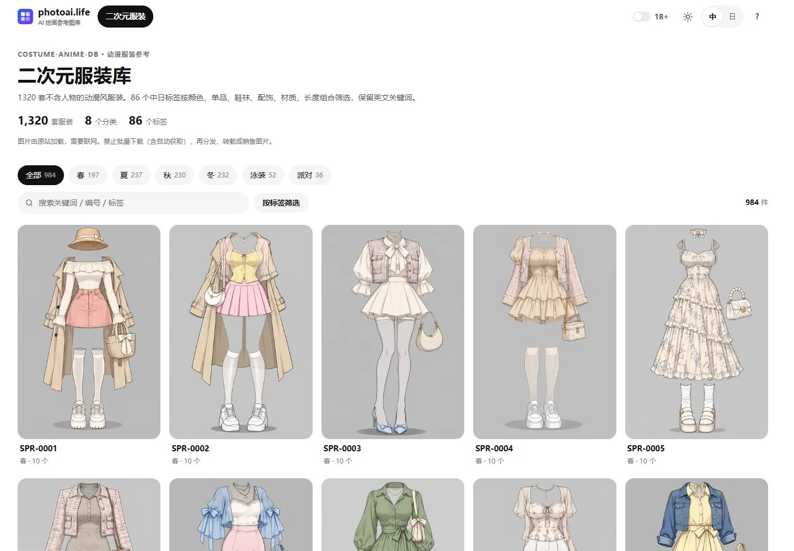
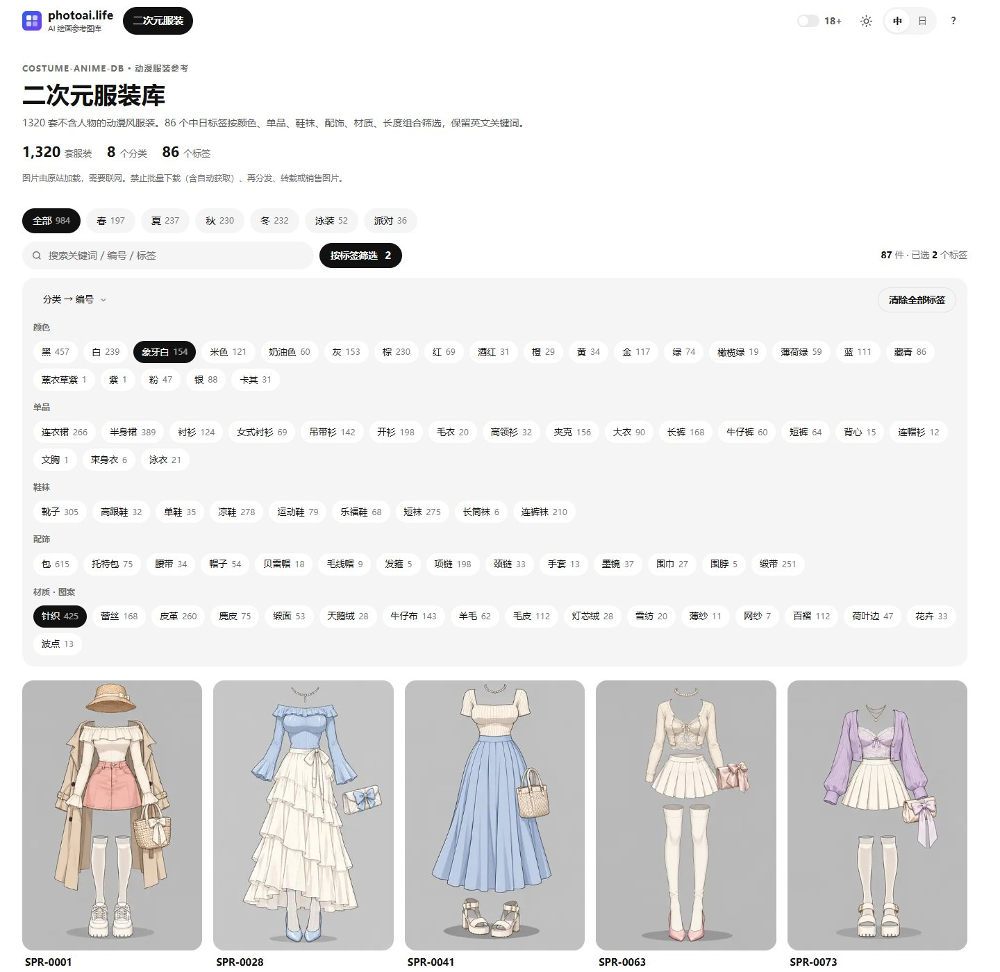
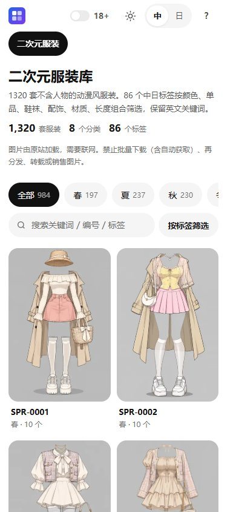

# 二次元服装参考图库 · Anime Costume Gallery 中文版

**1,320 套二次元服装 · 8 个分类 · 86 个英文标签 · 中日双语**

[photoai.life · 二次元服装入口](https://photoai.life/costume-anime/) · [全部参考图库](https://photoai.life/) · [主仓库](https://github.com/Brilliant666/ai-image-gallery) · [原站](https://ai-costume-anime-gallery.pages.dev/)

> 本库是独立可用的静态目录和中文界面。素材图片始终由原站提供，需要联网；不打包素材图片，不提供批量下载。仓库发布与 photoai.life 的生产部署是独立步骤，线上版本以实际部署为准。



<details>
<summary>更多截图：组合筛选与手机布局</summary>





</details>

截图于 2026-11-02 从本库独立构建的本地页面拍摄，18+ 关闭，未额外模糊处理。`docs/screenshots/` 仅用于演示界面，不改变截图内素材的原作者条件，不能从中裁取素材另用。

## 收录内容

| 分类 | 数量 |
| --- | ---: |
| 春 | 197 |
| 夏 | 237 |
| 秋 | 230 |
| 冬 | 232 |
| 泳装 | 52 |
| 派对 | 36 |
| 内衣（18+） | 197 |
| 性感（18+） | 139 |
| 合计 | 1,320 |

默认显示 984 套；内衣与性感类需经顶部 18+ 年龄确认，且不出现在任何静态分类 / 标签落地页。它与 [原服装集](https://github.com/Brilliant666/ai-costume-gallery-cn) 的 1,407 套服装来自两个目录，同编号不代表同一图片。

- 六组标签：颜色、单品、鞋袜、配饰、材质图案、长度；多选按 AND 筛选。
- 中文 / 日文 / 英文关键词及编号搜索，分类与排序，标签复制。
- 缩略图列表、单张放大和原站 PNG 链接，键盘操作，手机布局。
- 深浅主题、中日文切换，设置保存在本浏览器。
- 单文件画廊内嵌目录；从 file:// 打开仍可检索目录，图片必须联网。

## 使用

直接打开根目录 `index.html`，或 `sites/costume-anime/index.html`。前者提供直达图库与主站的入口。

重新构建只需 Python 3.8+ 标准库：

```bash
python build.py
```

本库只导出二次元服装的目录、模板、共用界面组件与服装标签词典。没有图片抓取脚本、账号配置或生图功能。共用组件放在 `shared/`，标签词典为 `sites/costume/scripts/translations.py`，新图库在 `sites/costume-anime/`。

上游目录维护方式见 [图库说明](sites/costume-anime/README.md)。这里是主仓库的导出快照；修正和后续同步优先向 [主仓库](https://github.com/Brilliant666/ai-image-gallery) 提交，避免两套源码独立漂移。

## 出处与许可

原作者：ギア（[@giaaibusi](https://x.com/giaaibusi)）。来源：[AI Costume Anime Gallery](https://ai-costume-anime-gallery.pages.dev/)。

原站允许作品制作中的商用、编辑和参考，禁止批量下载（含自动获取），禁止再分发、转载、转售图片本身（含原尺寸及加工后图片）。本库远程引用图片不代表取得额外授权；请阅读 [NOTICE](NOTICE.md)。

代码采用 [MIT](LICENSE)。本站独立编写的中文译文采用 CC BY 4.0，原站目录字段、英文关键词和图片不因此重新许可。

## 日本語

アニメ調衣装 1,320 着・8 カテゴリ・86 タグの中国語 / 日本語インデックスです。画像は元サイトから読み込み、一括取得やミラーは行いません。成人向け分類は初期状態で非表示です。`index.html` から利用でき、Python 3.8+ で再ビルドできます。[photoai.life](https://photoai.life/) で他の参考ライブラリも閲覧できます。

## English

An independent static Chinese/Japanese index of 1,320 anime-style outfits, with 8 categories and 86 English tags. Search, combine tag filters and copy tags; images load from the original site. The 336 lingerie/sexy entries are hidden until age confirmation and excluded from SEO landing pages. Only public UI screenshots are bundled; gallery image assets, a batch downloader and an image-generation service are not included. Open `index.html`, or rebuild using Python 3.8+. Visit [photoai.life](https://photoai.life/) for the full reference collection. Original data and images remain subject to the source author's terms.
